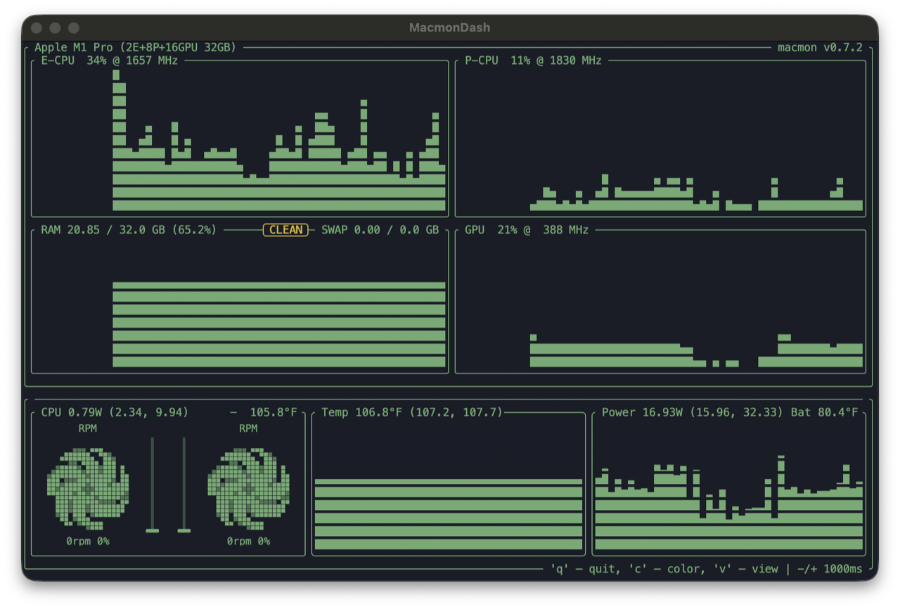
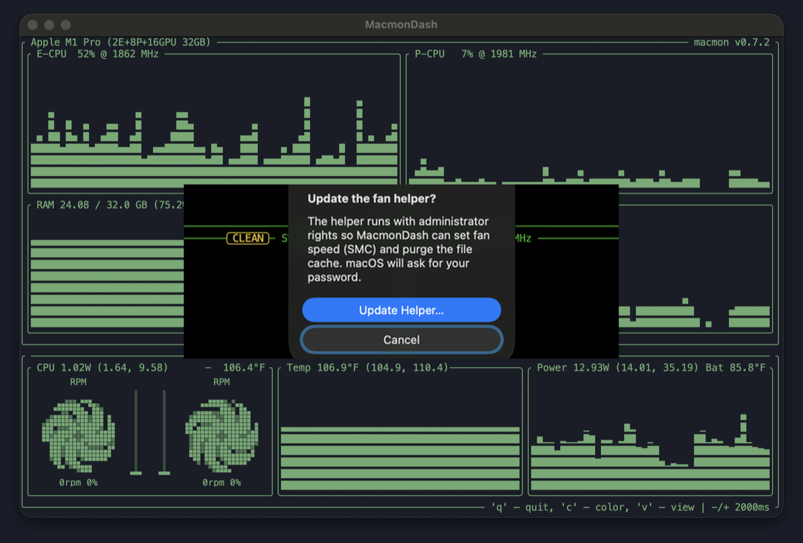

# MacmonDash

## Live Apple Silicon monitoring with fan control

A native Mac window for CPU, GPU, RAM, power, and temperature — plus fan sliders and a menu bar that keeps watching when you close the dashboard.

[](https://github.com/Eshan-khan1/MacmonDash/releases/latest/download/MacmonDash.dmg)



## Live dashboard

Efficiency and performance cores, GPU, RAM, power, and temps in °F — Clear Dark look, striped history graphs, resizable native window.

## Fan control

Two sliders set fan speed through the SMC. Heat-aware icons shift green → yellow → red as temps rise. Close the window and the menu bar still shows temp and fans; quit restores automatic. A helper watchdog returns fans to automatic if the app stops responding.

## CLEAN

One click stops idle background services (Spotlight indexers, Photos analysis, QuickLook thumbnails, and similar) and can flush the file cache. Launchd restarts services when needed. CLEAN never quits a visible app.

## Get the app

**Apple Silicon · macOS 14 or later**

1. [Download MacmonDash.dmg](https://github.com/Eshan-khan1/MacmonDash/releases/latest/download/MacmonDash.dmg) (or [MacmonDash.zip](https://github.com/Eshan-khan1/MacmonDash/releases/latest/download/MacmonDash.zip)).
2. Open the disk image and drag **MacmonDash** into **Applications**.
3. First launch: the app is open source and not notarized yet, so macOS may block it once. Right-click → **Open** → **Open**, or use **System Settings → Privacy & Security → Open Anyway**. After that, it opens normally.

Keyboard in the dashboard: `q` quit · `c` colour · `v` view · `-`/`+` sampling · `⌘0` all fans automatic.

## Trust

Monitoring needs nothing special. Fan control and CLEAN’s cache flush use a small privileged helper — MacmonDash explains and asks before installing it:



| Feature | Why admin |
|---|---|
| Fan sliders | Fan targets are written to the SMC (`F0Tg`, `F0Md`…), which only root may do. |
| CLEAN → cache flush | `/usr/sbin/purge` is root-only. Stopping background services does not need the helper. |

On **Allow**, macOS shows its own password dialog (the app never sees your password). Installed:

- `/usr/local/libexec/macmondash-fanhelper`
- `/Library/LaunchDaemons/com.local.macmondash.fanhelper.plist`
- socket `/var/run/macmondash-fan.sock` · log `/var/log/macmondash-fanhelper.log`

The helper accepts only `VERSION`, `PING`, `SET`, `AUTO`, and `PURGE`. RPM is clamped to 0–20 000. Thirty seconds without a ping while fans are manual → fans back to macOS.

**Remove anytime:** **MacmonDash → Remove Fan Helper…**, or:

```sh
sudo /Applications/MacmonDash.app/Contents/MacOS/MacmonDash --uninstall-fan-helper
```

Temps, fan RPM, and power stay on your Mac. No accounts, no analytics, no cloud.

> On a shared Mac, any local user can reach the helper socket and set fan speed — nothing else. Remove the helper when you’re done if that matters.

## Build from source

```sh
git clone https://github.com/Eshan-khan1/MacmonDash.git
cd MacmonDash
./Scripts/package-app.sh          # builds, assembles dist/MacmonDash.app, installs to /Applications
./Scripts/make-release.sh 1.0.0   # builds .zip + .dmg into dist/ (no install)
```

Needs Xcode 26 / Swift 6.2 or newer (SwiftTerm 1.99 requires it). Bundled `Resources/macmon` (0.7.2, TUI) and `macmon10` (0.10.0, JSON metrics) are unmodified upstream binaries. App icon: `python3 Scripts/make-icon.py` (needs Pillow).

## How it works

```
┌───────────────────────── MacmonDash.app ──────────────────────────┐
│ SwiftTerm ── runs ──▶ macmon 0.7.2 (TUI, drawn as-is)              │
│ MetricsPipe ─ runs ─▶ macmon10 pipe  (fans, temps, power as JSON)  │
│ Overlays on the terminal grid: fans+sliders, Temp, Power, CLEAN    │
│ HelperSetup ── explains, asks, then installs/updates the helper    │
└──────────────┬────────────────────────────────────────────────────┘
               │ unix socket  (SET / AUTO / PURGE / PING / VERSION)
┌──────────────▼────────────────────────────────────────────────────┐
│ macmondash-fanhelper (LaunchDaemon, root)                          │
│ AppleSMC writes for fan mode/target · purge · 30 s watchdog → auto │
└───────────────────────────────────────────────────────────────────┘
```

## Credits

- [macmon](https://github.com/vladkens/macmon) by vladkens — MIT
- [SwiftTerm](https://github.com/migueldeicaza/SwiftTerm) by Miguel de Icaza — MIT

## License

MIT — see [LICENSE](LICENSE).

## Shipping checklist

See [CHECKLIST.md](CHECKLIST.md) for the real-app backlog (permissions, support, notarization, privacy, and more).
